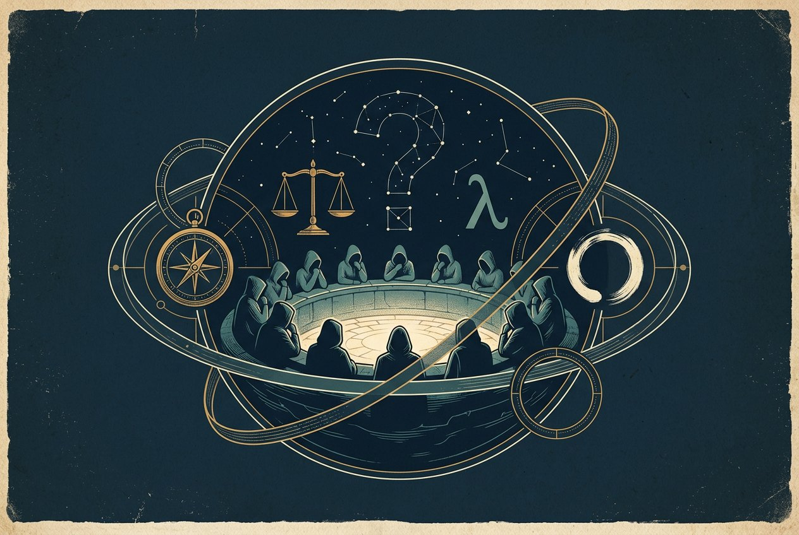
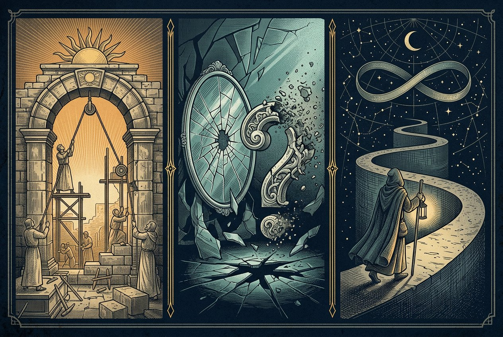

<p align="center">
  
</p>

<h1 align="center">真理未决</h1>

<p align="center">
  <b>THESIS / COUNTERTHESIS</b><br>
  一场关于公共命题的阵营推理桌游 · 4—8 名玩家 · 隐藏立场 · 公开表决
</p>

<p align="center">
  
  
  
  
  
  
</p>

<p align="center">
  <a href="https://matchayuki.github.io/Truth-Unsettled/"><b>📖 玩法介绍页</b></a>
  &nbsp;·&nbsp;
  <a href="https://matchayuki.github.io/Truth-Unsettled/play/"><b>🎲 游玩桌页面</b></a>
</p>

---

## 🧭 这是什么

《真理未决》把哲学史搬上一张牌桌。

每位玩家抽到一位**公开的**哲学家角色，和一张**秘密的**阵营牌。每轮开局翻开一道公共议题——「法律应优先保护自由还是秩序？」「公民是否有权拒绝服从？」——夜间由怀疑派暗中行动，白天全员围绕同一道命题组合出牌、相互诘问，最后由秘密投票决定它是否通过。

胜负不看谁说得漂亮，而看谁先把城邦推向自己的方向：**建构派**想把命题送上通过，**怀疑派**要让结论无法落地，**游士**只想完成那张没人知道的契约。

整套设计围绕一个前提：**信息不对称才是辩论的乐趣**。角色公开，阵营保密；票数公开，票向保密；有人倒下，但没人知道你为何倒下。

<p align="center">
  
  <br>
  <sub>手牌 · 投票标记（赞成 / 悬置 / 契约）· 心智石 · 议题卷轴 · 装备器物</sub>
</p>

---

## 🎭 三种立场，三套胜利条件

<p align="center">
  
  <br>
  <sub>左：建构派 · 中：怀疑派 · 右：游士</sub>
</p>

| 立场 | 桌面意象 | 你在做什么 | 胜利条件 |
| :-- | :-- | :-- | :-- |
| **Ⅰ 建构派**<br><sub>The Builders</sub> | ＋ 拱石与日出 | 推动公共规则落地，阻止城邦陷入停滞 | **至少 1 个议题通过**，且最终「通过」**不少于**「否决」（悬置中立，平票归建构派）；**或**淘汰全部怀疑派 |
| **Ⅱ 怀疑派**<br><sub>The Skeptics</sub> | ? 碎镜与尘 | 拆解共识，让议题无法形成稳定结论 | 最终「否决」**多于**「通过」，**或**全部议题悬置；**或**存活怀疑派人数**严格多于**其他所有存活玩家之和 |
| **Ⅲ 游士**<br><sub>The Wanderer</sub> | ∞ 提灯与螺旋 | 暗中推进一件私事，随时可能改换场面 | 满足自己抽到的秘密契约，**可与其他阵营共胜**（死亡契约出局后仍可成立） |

> 阵营与角色是**两套独立机制**：角色牌决定你能做什么（技能公开），阵营牌决定你为什么而赢（秘密持有）。历史人物不按史实学派固定归队——苏格拉底这一局可能是怀疑派，下一局也可能是建构派。

> **终局只看有效票**（0.9.6 起）：所有议题结算后，只比较已投出的**「通过」与「否决」**，**悬置中立、不参与比较**。通过 ≥ 否决且至少通过 1 个议题 → 建构派；否决 > 通过，或全部悬置 → 怀疑派；**平票归建构派**。至少完成一次公开表决后才宣布阵营胜负。

| 最终有效票 | 胜者 |
| :-- | :-- |
| 2 通过 / 1 悬置 | 建构派 |
| 1 通过 / 1 否决 / 1 悬置 | 建构派（平票归建构派） |
| 1 通过 / 2 否决 | 怀疑派 |
| 0 通过 / 3 悬置 | 怀疑派 |
| 3 通过 | 建构派 |

---

## 🕯️ 一局怎么走

| 阶段 | 发生什么 | 关键约束 |
| :-- | :-- | :-- |
| **① 抽取身份** | 每人一张公开角色牌 + 一张秘密阵营牌；游士另抽一张秘密契约 | 心智上限由角色决定，**2 或 3 点**（0.9.2 起下调 1 点）；**手牌上限 = 心智 + 1**，开局摸至上限 |
| **② 翻题与夜议** | 先公开本轮议题牌（题目 + 本轮效果）；全员闭眼，怀疑派睁眼互认并默选一人，主持人确认后结算 **1 点夜间伤害** | 主持人只公布结果，不公开是谁选的谁 |
| **③ 公开辩论** | 每轮**随机行动顺序**，每名存活玩家行动一次、**每人 120 秒**，可连续打出多张牌，也可提前结束；「反例」可在回合外响应 | 每回合最多 2 张「论证」、1 张「诘问」、1 张「辩论」，其他同名主牌各 1 张；手牌不超过心智 + 1 |
| **④ 秘密表决** | 全员同时秘密投**赞成 / 反对 / 悬置**；主持人只公布总票与结果 | 论证标记计入对应票数；超过存活人数一半即通过或否决，都未过半则悬置 |
| **⑤ 陶片放逐** | 每名存活玩家秘密选择一名其他存活玩家，**各投一枚陶片**；混合后**随机抽出一枚**，被抽中者失去 **1 点心智** | **结果公开、票向不公开**；30 秒未提交由系统随机补一枚，AI 也会投 |

**关于「多牌回合」**：这套规则没有「每回合只能打一张」的限制。节奏靠**同名上限**控制，不靠单张禁令——所以一回合里可以「论证 → 诘问 → 装备 → 再论证」，但同一种牌打不出第三张。装备槽固定为**一攻一守**：第一件直接装备，同栏第二件替换旧装备。**手牌上限 = 心智 + 1**，摸牌、收牌或心智下降后超出部分立即弃掉。

### 人数配置

| 玩家数 | 建构派 | 怀疑派 | 游士 | 议题数 | 每轮摸牌 |
| :--: | :--: | :--: | :--: | :--: | :--: |
| 4 人 | 2 | 1 | 1 | 3 | 1 张 |
| 5 人 | 3 | 1 | 1 | 3 | 1 张 |
| 6 人 | 3 | 2 | 1 | 5 | 2 张 |
| 7 人 | 4 | 2 | 1 | 5 | 2 张 |
| 8 人 | 4 | 3 | 1 | 5 | 2 张 |

实体局另需 **1 名不参战主持人**（不计入玩家数、不加入阵营、不计胜负）；线上版由应用代行主持流程。

---

## 🃏 牌库构成

**186 张组件，80 种卡面。**

| 组件 | 张数 | 说明 |
| :-- | :--: | :-- |
| 角色牌 | 25 | 每位哲学家一张，双技能，公开 |
| 主牌库 | 141 | 基础 72 · 锦囊 45 · 装备 24 |
| 议题牌 | 10 | 每轮公开 1 张：一道命题 + 一条本轮规则 |
| 游士契约 | 10 | 8 张要求存活到终局，2 张要求「完成目标后出局」 |

### 基础牌 72 张（51%）

| 牌名 | 张数 | 作用 |
| :-- | :--: | :-- |
| 论证 ⌁ | 12 | 选一个立场，+1 票影响；每人每议题最多保留 2 枚标记 |
| 诘问 ? | 10 | 指定一人：不出「反例」则失 1 心智，且本议题改为悬置 |
| 反例 ↶ | 10 | 抵消「诘问」，或移除场上 1 枚论证标记 |
| 研读 ▤ | 8 | 摸 2 弃 1 |
| 调息 ◌ | 8 | 恢复 1 心智，不超上限 |
| 引证 ❞ / 让步 ⇢ / 旁听 ◉ / 反思 ↺ / 求证 ⌕ / 共议 ⟷ | 各 4 | 强化票数、脱身、滤牌、转向、找牌、双向换牌 |

### 锦囊牌 45 张（32%）· 装备牌 24 张（17%）

锦囊以**强力但低复制**的方式存在：「辩论」8 张（对决，输者失心智且改悬置）；「归谬法」「公意契约」「奥卡姆剃刀」「思想实验」各 4 张；「议程改写」「修辞烟幕」「群体记忆」「众声合鸣」各 3 张。

装备共 **12 款各 2 张**，进攻与防守各 12 张：

> 诡辩手杖 · 尼采之锤 · 达摩克利斯之剑 · 亚里士多德逻辑尺 · 阿基米德杠杆 · 修辞面具 · 汉谟拉比法典 · 佛珠 · 八卦镜 · 玫瑰经念珠 · 斯多亚斗篷 · 塔斯比念珠

### 议题牌：这轮到底在争什么

十道命题，每张同时写明**公共问题**和**本轮规则效果**——题目决定讨论什么，效果决定这一轮怎么玩（改变资源、技能、装备或投票门槛），结算后弃置。

> 城邦是否应限制财富差距？／法律应优先保护自由还是秩序？／善意能否抵消制度造成的伤害？／知识来自理性、经验，还是共同生活？／多数人可能犯错时，少数能否阻止决定？／幸福来自欲望满足，还是欲望减少？／财产权是否应当不可侵犯？／公民是否有权拒绝服从？／异议是否应当被保留？／争议是否必须由多数裁决？

### 游士契约：一个只属于你的胜利目标

> 心智守望 · 藏书人 · 合议者 · 异议者 · 悬置见证者 · 连环论者 · 不伤者 · 器物守护者 · 殉道者 · 反证者

契约只发给游士，且全程保密。**死亡契约**不让持有者复活或继续行动，但达成契约的已出局游士同样计为胜者——这是整套设计里最容易被低估的一手。

---

## 👤 25 位哲学家

跨越古希腊、先秦、伊斯兰黄金时代、拉丁经院、近代早期与 20 世纪。每张角色牌两项技能，多数为「每议题一次」，少数为「每局一次」，强度越高心智上限越低（2 点），常规角色为 3 点。

| 思想传统 | 人物 |
| :-- | :-- |
| 古希腊 | 苏格拉底 · 柏拉图 · 亚里士多德 · 伊壁鸠鲁 · 第欧根尼 · 希帕提娅 |
| 先秦 | 孔子 · 老子 · 庄子 · 墨子 · 孟子 · 荀子 · 韩非 |
| 伊斯兰与经院 | 伊本·西那 · 安萨里 · 托马斯·阿奎那 |
| 近代与当代 | 笛卡尔 · 斯宾诺莎 · 洛克 · 休谟 · 康德 · 马克思 · 尼采 · 黑格尔 · 汉娜·阿伦特 |

技能都从思想本身长出来，而不是贴标签：柏拉图的「洞穴寓言」允许在计票后、公布前秘密改票；庄子的「齐物」能把论证标记在两个立场间挪动；休谟的「因果怀疑」取消刚发生的一项非伤害效果；阿伦特的「公共领域」每局一次强制重投。

**完整卡面、技能原文与史料出处**：见[玩法介绍页 · 卡牌图鉴](https://matchayuki.github.io/Truth-Unsettled/#page-3)，支持按牌类筛选和关键词搜索。

---

## ⚙️ 两种打开方式

### A. 线上浏览（静态托管，随时可看）

- 玩法介绍 → <https://matchayuki.github.io/Truth-Unsettled/>
- 游玩桌 → <https://matchayuki.github.io/Truth-Unsettled/play/>

⚠️ **GitHub Pages 只托管静态文件，不运行 `play/server.js`。** 游玩桌页面可以打开、可以看清全部卡面与流程，但「创建房间 / 加入房间」是禁用状态——那两个按钮需要真实的牌局服务。

### B. 本地或局域网开一局（可真正联机）

```bash
# Windows：双击 play/start-lan.cmd（会自动打开浏览器并启动服务）
# 或手动：
node play/server.js          # 默认 http://localhost:4317
```

1. 主持人启动服务，保持窗口开启；
2. 主持人选择人数、创建房间，把页面显示的**局域网地址**发给玩家；
3. 玩家连同一 Wi-Fi，用手机或电脑打开该地址，输入房间号与昵称；
4. 人齐后由主持人开始。

其他人只需访问主持人的 `http://局域网IP:4317`，无需云服务器、无需账号。若 Windows 防火墙询问，请允许**专用网络**。不要直接双击 `play/index.html`——那样连不上本机服务。

---

## 📁 目录结构

```text
.
├── index.html          # 玩法介绍：首屏 / 基础规则 / 卡牌图鉴（单页三折）
├── style.css           # 纸感底色、刻线分隔、书页翻动
├── app.js              # 卡牌数据渲染、筛选搜索、翻页与弹窗
├── play/
│   ├── index.html      # 独立游玩页（玩家视图 / 主持人视图）
│   ├── play.js         # 房间交互与状态同步
│   ├── cards.js        # 卡牌与角色数据（25 角色 + 全部牌库）
│   ├── server.js       # Node 房间服务，内存态，端口 4317
│   ├── start-lan.cmd   # Windows 一键启动脚本
│   └── style.css
├── assets/             # README 插画（AI 生成）
├── .nojekyll           # 让 Pages 按静态文件发布
└── README.md
```

页面之间不共享脚本与样式：介绍页和游玩页是两套独立的 HTML / CSS / JS，方便分别修改。

---

## 🧪 设计边界与已知限制

<details>
<summary><b>哪些自动、哪些靠主持人裁定</b></summary>

应用已自动处理：身份与手牌分配、秘密夜间目标、心智变化、论证标记、诘问响应、辩论对决、装备槽、秘密投票汇总、轮次推进。每回合可以连续出多张牌。

**角色技能，以及部分基础牌、锦囊牌、议题牌的特殊效果，由主持人依据牌面文字裁定**；「玩家状态」面板可辅助调整心智、摸牌弃牌、处理论证标记与装备、判定出局。游士契约的终局检查自动处理常见目标，但仍需主持人核对具体情形。

——它是一张能减轻主持负担的电子桌，**不是全自动裁判**。

</details>

<details>
<summary><b>平衡是首轮试玩基线，不是结论</b></summary>

72 / 45 / 24 的比例是为了让核心攻防牌（论证、诘问、反例）容易摸到，同时用强锦囊的低复制数压住连锁爆发。首轮试玩重点观察三件事：怀疑派夜间伤害是否过强、「辩论」是否过早压低投票参与、游士契约是否太难完成。

**当前牌数未经充分实测，不宣称是最终平衡。**

</details>

<details>
<summary><b>关于插画</b></summary>

本页三张配图由 AI 生成，用于呈现主题气质，**不是史料图像**。卡牌原画尚未生成——介绍页目前展示的是卡框、符号与排版草案。

</details>

<details>
<summary><b>关于史料</b></summary>

人物介绍与技能灵感依据各角色卡链接的 Wikipedia 条目摘要整理。人物能力是桌游化创作，**不代表真实历史人物拥有超自然力量**，也不把哲学家按历史学派固定分队。宗教与历史器物以机制象征呈现；正式印制前建议复核器物名称、历史语境与视觉表现。

</details>

---

<p align="center">
  <sub>原型规则 · 玩法与胜负判定已同步至小游戏 0.9.6<br>
  规则、卡面与数值都可能被推翻 —— 这大概很符合它的名字。</sub>
</p>
